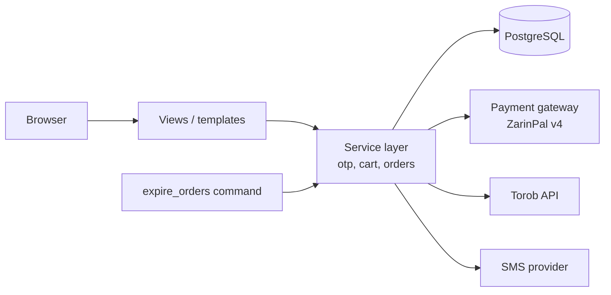

# ModaStore

A digital-goods e-commerce store built with **Django 6** and **PostgreSQL**: OTP phone login, catalog with filtering, cart, ZarinPal checkout with stock reservation, wishlist, reviews, and price lookup through the Torob API.
The UI is Persian (RTL), mobile-first, with desktop-only motion.

> Portfolio project. It is not deployed; everything runs locally.

<!-- Replace with real screenshots (see docs/screenshots/) -->
| Home | Product list | Profile |
|---|---|---|
|  |  |  |

## Features

- **Auth:** passwordless phone + OTP login (rate-limited, attempt-limited, expiring codes).
- **Catalog:** categories, brands, variants, search, price / brand / rating / on-sale filters, grid/list toggle, bottom-sheet filters on mobile.
- **Cart:** session/user cart with live stock checks.
- **Checkout & payments:** ZarinPal v4 gateway, addresses, order state machine
  (`pending → processing → shipped → delivered`, or `canceled`).
- **Stock safety:** stock is reserved at checkout, unpaid orders expire after 30 minutes and stock is released
  (`python manage.py expire_orders`). A payment that lands after expiry re-reserves stock or is flagged `refund_needed`.
- **Wishlist, reviews & ratings**, user profile with addresses and recent orders.
- **Static pages:** about, contact (honeypot + rate limit), FAQ, terms, returns; custom 403/404/500.
- **Accessibility/UX:** RTL, keyboard-friendly dialogs, `prefers-reduced-motion` respected.

## Architecture



| App | Responsibility |
|---|---|
| `accounts` | Users, OTP service, addresses, profile |
| `catalog` | Categories, brands, products, variants, home & list pages |
| `cart` | Cart and its service layer |
| `orders` | Checkout, order state machine, gateway client, expiry command |
| `wishlist` | Saved products |
| `reviews` | Ratings and reviews |
| `api` | JSON endpoints |
| `pages` | Static pages, contact form, error handlers |

Business rules live in `services.py` modules, so views stay thin and the rules are unit-testable.

## Getting started

Requirements: Python 3.13, PostgreSQL 14+.

```bash
git clone <repo-url> && cd ModaStore
python -m venv venv
venv\Scripts\activate          # Windows  (Linux/macOS: source venv/bin/activate)
pip install -r requirements.txt

cp .env.example .env           # then edit values
createdb modastore             # or create the DB with pgAdmin

cd modastore
python manage.py migrate
python manage.py createsuperuser
python manage.py runserver
```

Open <http://127.0.0.1:8000>. In development, OTP codes are printed in the console and the payment gateway can be mocked.

Cancel overdue unpaid orders (run it from cron/Task Scheduler in a real deployment):

```bash
python manage.py expire_orders
```

## Tests

```bash
python manage.py test
```

139 tests cover OTP rules, cart, order services (payment success/failure/refund/expiry) and views. The gateway is mocked, so no network is needed.

Coverage:

```bash
pip install coverage
coverage run manage.py test
coverage report
```

Total coverage: **83%** (config in `.coveragerc`).

## Notes

- ZarinPal and Torob calls are isolated behind small client modules and mocked in tests.
- Sample text on the static pages (phone, email, address, return policy) is placeholder content.
- Not included on purpose: Docker, CI and production hardening, since the project is not deployed.

## License

MIT (or your choice — add a `LICENSE` file).
